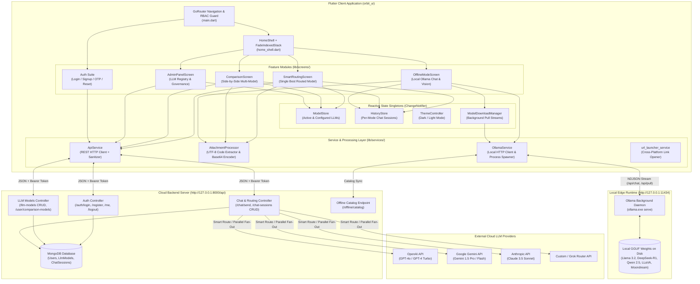
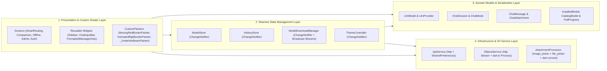
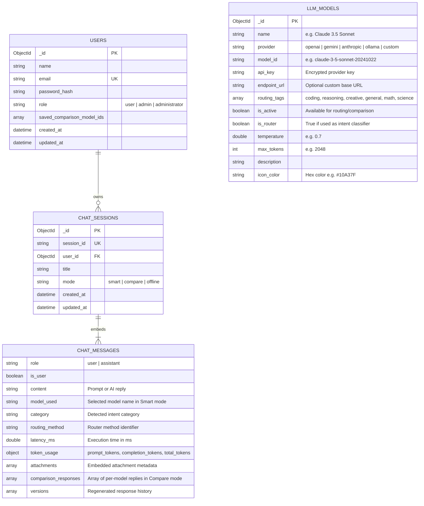
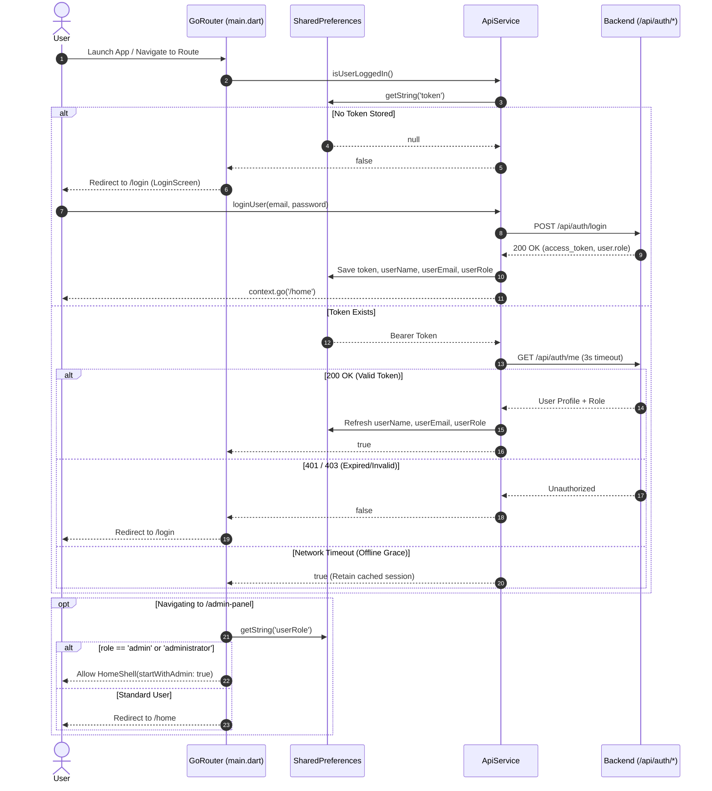
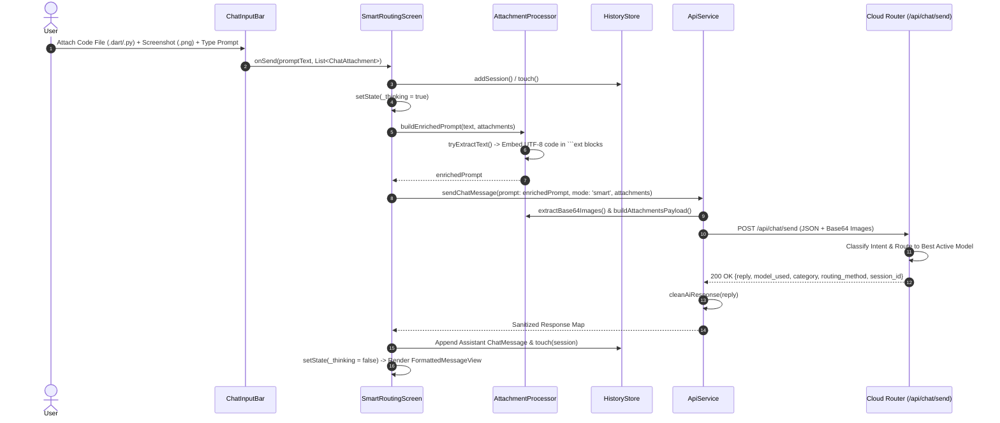
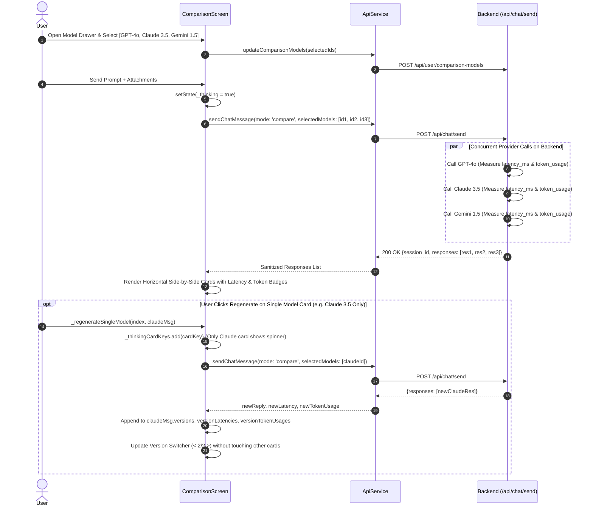
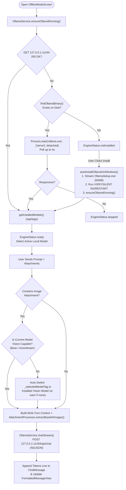

# Orbit AI (Neural Route AI Agent)

**Intelligent Multi-Model AI Routing, Live Parallel Model Comparison & Local Edge Inference Platform**

> **Thesis & Technical Documentation Edition**  
> This document provides an authentic, exhaustive, code-verified architectural and functional reference of the **Orbit AI (`orbit_ui`)** platform. Every module, backend endpoint, state store, data model, UI screen, custom shader painter, and **every individual function/method** in the codebase is documented in detail—explaining **what** each function does, **how** it operates internally, and **why** it was engineered (its architectural and thesis justification).

---

## Metadata & Project Summary

| Attribute | Authentic Project Specification |
|-----------|----------------------------------|
| **Application Name** | Orbit AI (`orbit_ui` / Neural Route AI Agent) |
| **Core Paradigm** | Hybrid Cloud + Edge Multi-Model AI Routing & Evaluation Platform |
| **Frontend Framework** | Flutter (Dart SDK `>=3.0.0 <4.0.0`, Material 3) |
| **Routing & Navigation** | Declarative `GoRouter` (`^17.5.0`) with Async Auth & RBAC Redirect Guards + `FadeIndexedStack` Shell |
| **Cloud Backend API** | RESTful API (`http://127.0.0.1:8000/api`) — Laravel / Python AI Gateway with MongoDB (`$oid`) Persistence |
| **Local Edge Engine** | Direct HTTP & Process Integration with **Ollama** (`http://127.0.0.1:11434`) + Windows Silent Auto-Installer |
| **Supported Operational Modes** | 1. **Smart Routing Mode** (Automated prompt classification & routing)<br>2. **Comparison Mode** (Parallel multi-LLM execution with latency & token telemetry)<br>3. **Offline Mode** (Zero-cloud local LLM & Vision inference via Ollama)<br>4. **Admin Panel** (Role-gated LLM registry & router governance) |
| **Multimodal Capabilities** | Real-time Codebase/Document Text Extraction (38+ file types) + Base64 Image Vision Payloads |

---

## Table of Contents

1. [Executive Summary & Thesis Motivation](#1-executive-summary--thesis-motivation)
2. [Authentic Implementation Matrix (Real vs. Fallback Features)](#2-authentic-implementation-matrix-real-vs-fallback-features)
3. [System Architecture & High-Level Graphs](#3-system-architecture--high-level-graphs)
4. [Backend Architecture, Database Schema & REST API Specification](#4-backend-architecture-database-schema--rest-api-specification)
5. [Local Edge Backend: Ollama Runtime & Streaming Protocol](#5-local-edge-backend-ollama-runtime--streaming-protocol)
6. [Complete Function-by-Function Thesis Reference (All Files & Modules)](#6-complete-function-by-function-thesis-reference-all-files--modules)
   - [6.1 Application Entry & Declarative Routing (`lib/main.dart`)](#61-application-entry--declarative-routing-libmaindart)
   - [6.2 Design System & Reactive Theme Engine (`lib/app_theme.dart`)](#62-design-system--reactive-theme-engine-libapp_themedart)
   - [6.3 Domain Data Models & Reactive Stores (`lib/models.dart`)](#63-domain-data-models--reactive-stores-libmodelsdart)
   - [6.4 Cloud REST API Service & Response Sanitizer (`lib/services/api_services.dart`)](#64-cloud-rest-api-service--response-sanitizer-libservicesapi_servicesdart)
   - [6.5 Multimodal Attachment Processor (`lib/services/attachment_processor.dart`)](#65-multimodal-attachment-processor-libservicesattachment_processordart)
   - [6.6 Local Ollama Engine Service (`lib/services/ollama_service.dart`)](#66-local-ollama-engine-service-libservicesollama_servicedart)
   - [6.7 Background Model Download Manager (`lib/services/model_download_manager.dart`)](#67-background-model-download-manager-libservicesmodel_download_managerdart)
   - [6.8 External URL Launcher Service (`lib/services/url_launcher_service.dart`)](#68-external-url-launcher-service-libservicesurl_launcher_servicedart)
   - [6.9 Resilient Fallback Response Generator (`lib/services/dummy_response_generator.dart`)](#69-resilient-fallback-response-generator-libservicesdummy_response_generatordart)
   - [6.10 Smart Routing Module (`lib/screens/smart_routing_screen.dart`)](#610-smart-routing-module-libscreenssmart_routing_screendart)
   - [6.11 Parallel Comparison Module (`lib/screens/comparison_screen.dart`)](#611-parallel-comparison-module-libscreenscomparison_screendart)
   - [6.12 Offline Edge AI Module (`lib/screens/offline_mode_screen.dart`)](#612-offline-edge-ai-module-libscreensoffline_mode_screendart)
   - [6.13 Admin Governance Module (`lib/screens/admin_panel_screen.dart`)](#613-admin-governance-module-libscreensadmin_panel_screendart)
   - [6.14 Authentication Suite (`lib/screens/auth/*.dart`)](#614-authentication-suite-libscreensauthdart)
   - [6.15 Core Shell, Sidebar, Input Bar & Custom Shaders (`lib/widgets/*.dart`)](#615-core-shell-sidebar-input-bar--custom-shaders-libwidgetsdart)
7. [Detailed Sequence, State & Data-Flow Diagrams](#7-detailed-sequence-state--data-flow-diagrams)
8. [Project Directory Structure](#8-project-directory-structure)
9. [Environment Setup & Execution Guide](#9-environment-setup--execution-guide)
10. [Thesis Chapter Mapping Guide](#10-thesis-chapter-mapping-guide)

---

## 1. Executive Summary & Thesis Motivation

### 1.1 Problem Statement
Modern Large Language Model (LLM) ecosystems are highly fragmented. Different foundation models exhibit specialized strengths:
- **Anthropic Claude 3.5 Sonnet / Opus** excels at complex software engineering, code refactoring, and nuanced prose.
- **OpenAI GPT-4o** provides strong general-purpose reasoning and multimodal versatility.
- **Google Gemini 1.5 Pro** offers massive context windows and fast document synthesis.
- **DeepSeek-R1 / Qwen 2.5 Coder / Llama 3.2 (via Ollama)** enable private, zero-cost, air-gapped local execution on consumer hardware.

In conventional workflows, users face four major bottlenecks:
1. **Cognitive Routing Overhead:** Users must manually decide which model fits their current prompt and switch browser tabs or applications.
2. **Lack of Empirical Side-by-Side Evaluation:** Comparing model accuracy, response latency (`ms`), and token efficiency (`total_tokens`) on the exact same prompt and file attachments requires manual copy-pasting across multiple platforms.
3. **Cloud Connectivity & Privacy Constraints:** Cloud-only platforms fail when internet connectivity drops or when sensitive source code/documents cannot leave the local machine.
4. **Lack of Centralized Model Governance:** Organizations lack a unified administrative plane to dynamically register models, configure routing tags (`coding`, `reasoning`, `math`, `creative`, `science`), adjust inference hyperparameters (`temperature`, `max_tokens`), and designate router models without redeploying client applications.

### 1.2 Proposed Solution: Orbit AI
**Orbit AI** solves these challenges by unifying **Cloud Smart Routing**, **Live Multi-Model Comparison**, **Local Offline Ollama Inference**, and **Role-Based Administrative Governance** inside a single cross-platform Flutter application backed by a RESTful API and a local Ollama daemon.

---

## 2. Authentic Implementation Matrix (Real vs. Fallback Features)

Unlike early design mockups, this codebase implements **real network, process, and file-system integrations**. For academic transparency in thesis evaluation, the table below documents the exact implementation status of every subsystem in the repository:

| Subsystem / Feature | Implementation Status | Technical Mechanism in Codebase |
|---------------------|-----------------------|---------------------------------|
| **User Login & JWT Session** | **100% Real (Live API)** | `POST /api/auth/login` via `ApiService.loginUser()`; stores Bearer `access_token`, `userName`, `userEmail`, and `userRole` in `SharedPreferences`. |
| **User Registration** | **100% Real (Live API)** | `POST /api/auth/register` via `ApiService.registerUser()`. |
| **Session Verification & RBAC Guard** | **100% Real (Live API + Router)** | `GoRouter.redirect` calls `ApiService.isUserLoggedIn()` (`GET /api/auth/me` with 3s timeout & offline token retention) and enforces admin role check on `/admin-panel`. |
| **User Logout** | **100% Real (Live API)** | `POST /api/auth/logout` via `ApiService.logoutUser()` + clears local `SharedPreferences` credentials. |
| **Forgot Password / OTP / Reset Password** | **UI + Client Validation (Simulated Delay)** | `ForgotPasswordScreen`, `OtpScreen`, and `ResetPasswordScreen` validate inputs via `AuthValidators` and use a `700ms` `Future.delayed` timer for UX demonstration. |
| **Smart Routing Chat** | **100% Real (Live API + Fallback)** | Sends enriched prompt + Base64 images/attachments to `POST /api/chat/send` (`mode: 'smart'`). Displays backend-selected `model_used`, `category`, and `routing_method`. Uses `DummyResponseGenerator` only as a resilience fallback if backend regeneration fails. |
| **Parallel Comparison Mode** | **100% Real (Live API)** | Loads/saves user's preferred models via `GET` & `POST /api/user/comparison-models`. Sends `POST /api/chat/send` (`mode: 'compare'`, `selected_models`). Displays per-model `latency_ms` and `token_usage`. Supports isolated single-model regeneration. |
| **Offline Mode (Local AI)** | **100% Real (Local Ollama Engine)** | Connects to `http://127.0.0.1:11434`. Auto-detects `ollama.exe`, launches `ollama serve` in background, or runs a 1-click silent Windows installer (`OllamaSetup.exe /VERYSILENT`). Streams live tokens via `POST /api/chat` and auto-switches to local Vision models (`llava`, `moondream`) when images are attached. |
| **Offline Model Download Manager** | **100% Real (Streaming HTTP)** | Singleton `ModelDownloadManager` streams `POST /api/pull` NDJSON byte progress, supporting background persistence across tabs, Pause (`cancel()` stream), Resume (layer blob continuation), Cancel, and Disk Deletion (`DELETE /api/delete`). |
| **Chat History Persistence** | **100% Real (Live API + Cache)** | `HistoryStore` synchronizes with `GET /api/chat-sessions`, lazy-loads full message trees via `GET /api/chat-sessions/{id}`, renames via `PUT /api/chat-sessions/{id}`, and deletes via `DELETE /api/chat-sessions/{id}`. |
| **Admin Model CRUD** | **100% Real (Live API)** | `ModelStore` executes `GET / POST / PUT / DELETE /api/llm-models` with optimistic UI toggling (`toggleActiveViaApi`) and automatic rollback on failure. |
| **Code & Image Attachments** | **100% Real (Native Pickers + Parser)** | Uses `image_picker` and `file_picker`. `AttachmentProcessor` reads raw `Uint8List` bytes, extracts UTF-8 source code from 38+ text/code extensions into fenced Markdown blocks, and Base64-encodes images for multimodal vision APIs. |

---

## 3. System Architecture & High-Level Graphs

### 3.1 End-to-End Hybrid System Architecture

The platform follows a **Three-Tier Hybrid Architecture** combining a reactive Flutter presentation client, a centralized RESTful Cloud API Gateway (with MongoDB persistence), and a direct Local Edge Inference Engine (Ollama).



---

### 3.2 Layered Software Architecture inside Flutter



---

## 4. Backend Architecture, Database Schema & REST API Specification

Even though this repository houses the Flutter client code, the client is tightly coupled to a specific backend contract (`http://127.0.0.1:8000/api`) designed with **Laravel/Python REST controllers** and **MongoDB** document storage (evidenced by MongoDB ObjectId `{"_id": {"$oid": "..."}}` parsing in `lib/models.dart`). Below is the complete backend architecture and API specification required for thesis documentation.

### 4.1 Backend Database Schema (MongoDB Collections)



### 4.2 Complete Backend REST API Endpoints

#### A. Authentication Endpoints
1. **`POST /api/auth/register`**
   - **Purpose:** Creates a new user account in the database.
   - **Request Body:** `{"name": "...", "email": "...", "password": "...", "password_confirmation": "..."}`
   - **Success Response (`200` / `201`):** Returns created user object.
2. **`POST /api/auth/login`**
   - **Purpose:** Authenticates user credentials and issues a Bearer token.
   - **Request Body:** `{"email": "...", "password": "..."}`
   - **Success Response (`200`):**
     ```json
     {
       "access_token": "eyJhbGciOiJIUzI1NiIs...",
       "user": {
         "name": "Academic Researcher",
         "email": "researcher@university.edu",
         "role": "admin"
       }
     }
     ```
3. **`GET /api/auth/me`**
   - **Purpose:** Validates an existing Bearer token on route navigation (`GoRouter.redirect`) and refreshes local role/profile state.
   - **Headers:** `Authorization: Bearer <token>`
   - **Behavior:** Returns `200` with user profile if valid; returns `401`/`403` if expired/invalid.
4. **`POST /api/auth/logout`**
   - **Purpose:** Invalidates the current user's server-side access token.

#### B. LLM Catalog & Governance Endpoints
5. **`GET /api/llm-models`**
   - **Purpose:** Retrieves all registered LLM configurations from MongoDB. Supports wrapped (`data`, `models`, `llm_models`) or root array responses.
6. **`POST /api/llm-models`**
   - **Purpose:** Registers a new cloud or local LLM in the catalog (Admin only).
   - **Payload:** `name`, `provider`, `model_id`, `routing_tags`, `is_active`, `is_router`, `temperature`, `max_tokens`, `api_key`, `endpoint_url`, `description`.
7. **`PUT /api/llm-models/{id}`**
   - **Purpose:** Updates an existing LLM's configuration or toggles its `is_active` state.
8. **`DELETE /api/llm-models/{id}`**
   - **Purpose:** Permanently removes an LLM configuration from the registry.

#### C. User Comparison Preferences Endpoints
9. **`GET /api/user/comparison-models`**
   - **Purpose:** Fetches the authenticated user's persisted selection of comparison model IDs (`{"saved_model_ids": ["id1", "id2"]}`).
10. **`POST /api/user/comparison-models`**
    - **Purpose:** Persists the user's selected model IDs (`{"model_ids": [...]}`) so their comparison workspace is restored across sessions.

#### D. Core AI Routing & Multi-Model Chat Endpoint
11. **`POST /api/chat/send`**
    - **Purpose:** Unified inference endpoint handling both **Smart Routing** (`mode: "smart"`) and **Parallel Comparison** (`mode: "compare"`).
    - **Request Payload:**
      ```json
      {
        "prompt": "Enriched prompt text with embedded fenced code...",
        "mode": "smart | compare",
        "session_id": "optional_existing_session_id",
        "selected_models": ["model_id_1", "model_id_2"],
        "images": ["<base64_encoded_image_string>"],
        "attachments": [
          {
            "name": "main.dart",
            "is_image": false,
            "file_type": "project",
            "size": 4120,
            "base64": "..."
          }
        ]
      }
      ```
    - **Backend Execution Logic:**
      - **When `mode == "smart"`:**
        1. Inspects the active router model (`is_router == true`) or runs keyword/intent classification over the prompt and attachments.
        2. Classifies the prompt into a specialty domain (`coding`, `reasoning`, `math`, `creative`, `science`, `general`).
        3. Selects the highest-priority active model matching `routing_tags`.
        4. Dispatches the prompt (and Base64 vision payload if present) to the chosen provider SDK/API.
        5. Stores the user message and assistant response in `CHAT_SESSIONS` and returns:
           `{"reply": "...", "model_used": "Claude 3.5 Sonnet", "category": "coding", "routing_method": "llm_router", "session_id": "..."}`.
      - **When `mode == "compare"`:**
        1. Iterates concurrently over `selected_models`.
        2. Measures execution time (`latency_ms`) and captures provider token telemetry (`token_usage.total_tokens`) for each model independently.
        3. Appends the comparison response group to `CHAT_SESSIONS` and returns:
           ```json
           {
             "session_id": "...",
             "responses": [
               {
                 "model_name": "GPT-4o",
                 "status": "success",
                 "reply": "...",
                 "latency_ms": 1240.5,
                 "token_usage": {"total_tokens": 385}
               },
               {
                 "model_name": "Claude 3.5 Sonnet",
                 "status": "success",
                 "reply": "...",
                 "latency_ms": 980.2,
                 "token_usage": {"total_tokens": 410}
               }
             ]
           }
           ```

#### E. Chat Session History Endpoints
12. **`GET /api/chat-sessions`** — Returns all chat sessions belonging to the user.
13. **`GET /api/chat-sessions/{id}`** — Lazy-loads the full message array for a specific session when opened from the sidebar.
14. **`PUT /api/chat-sessions/{id}`** — Renames a chat session (`{"title": "New Title"}`).
15. **`DELETE /api/chat-sessions/{id}`** — Deletes a chat session and its messages.
16. **`GET /api/offline/catalog`** — Returns tiered hardware recommendations (`entry_level` 4GB RAM, `balanced` 8GB RAM, `pro` 16GB RAM) for local Ollama models.

---

## 5. Local Edge Backend: Ollama Runtime & Streaming Protocol

In **Offline Mode**, Orbit AI bypasses cloud inference entirely and communicates directly with the local **Ollama daemon** on `http://127.0.0.1:11434`:

| Local Endpoint | Method | Protocol | Purpose in Orbit AI |
|----------------|--------|----------|---------------------|
| `http://127.0.0.1:11434/` | `GET` | HTTP `200 OK` | Health check (`OllamaService.isOllamaRunning`) with `1800ms` timeout. |
| `http://127.0.0.1:11434/api/tags` | `GET` | JSON | Lists locally installed GGUF models, byte sizes, parameter counts, and quantization levels (`getInstalledModels`). |
| `http://127.0.0.1:11434/api/pull` | `POST` | Chunked NDJSON Stream | Downloads model layers from the Ollama registry while emitting real-time `status`, `completed`, and `total` byte counts (`pullModelStream`). |
| `http://127.0.0.1:11434/api/delete` | `DELETE` | JSON | Deletes a local model (`{"name": modelId}`) to reclaim disk space (`deleteModel`). |
| `http://127.0.0.1:11434/api/chat` | `POST` | Chunked NDJSON Stream | Streams live token generation (`message.content`) with full multi-turn context and Base64 `images` array for local vision models (`chatStream`). |

---

## 6. Complete Function-by-Function Thesis Reference (All Files & Modules)

This section provides a **complete, authentic academic breakdown** of every file, class, and function in the project, detailing **what** each function does and **why** it is used.

---

### 6.1 Application Entry & Declarative Routing (`lib/main.dart`)

[`lib/main.dart`](lib/main.dart) initializes the Flutter binding, attaches the reactive theme listener, and configures declarative URL routing with security guards.

| Function / Method | Signature | What It Does (Mechanism) | Why It Is Used (Thesis Justification) |
|-------------------|-----------|--------------------------|---------------------------------------|
| `main` | `void main()` | Invokes `runApp(const OrbitApp())`. | Standard Dart entrypoint that mounts the root widget tree onto the Flutter engine. |
| `_OrbitAppState.build` | `Widget build(BuildContext context)` | Wraps `MaterialApp.router` inside a `ListenableBuilder` listening to `themeController`. Configures `AppTheme.light()`, `AppTheme.dark()`, `themeMode`, and `_router`. | Decouples global theme switching from navigation state so toggling Dark/Light mode rebuilds visual themes instantaneously without resetting active routes or chat sessions. |
| `_router` (`redirect`) | `FutureOr<String?> Function(BuildContext, GoRouterState)` | 1. Calls `await ApiService.isUserLoggedIn()`.<br>2. Redirects unauthenticated users to `/login` unless they are already visiting `/login` or `/signup`.<br>3. Redirects authenticated users away from `/login` or `/signup` to `/home`.<br>4. If navigating to `/admin-panel`, reads `userRole` from `SharedPreferences` and blocks non-admin users by redirecting to `/home`. | Implements **Centralized Route Guarding & Role-Based Access Control (RBAC)** at the router level, preventing unauthorized deep-linking or URL manipulation on Web and Desktop builds. |
| `GoRoute('/home')` (`pageBuilder`) | `Page<dynamic> Function(BuildContext, GoRouterState)` | Parses optional `?tab=` query parameter or `state.extra` integer and returns a `NoTransitionPage` wrapping `HomeShell`. | Enables direct deep-linking to specific operational modes (e.g., `/home?tab=1` for Comparison Mode) with zero jarring page transition animations. |

---

### 6.2 Design System & Reactive Theme Engine (`lib/app_theme.dart`)

[`lib/app_theme.dart`](lib/app_theme.dart) centralizes color tokens, Material 3 `ThemeData` factories, context extensions, and the singleton `ThemeController`.

| Class / Function / Getter | Signature | What It Does (Mechanism) | Why It Is Used (Thesis Justification) |
|---------------------------|-----------|--------------------------|---------------------------------------|
| `AppColors` | `class AppColors` | Defines static `Color` constants for primary accents (`purple` / OpenAI Green `0xFF10A37F`), dark surfaces (`darkBg`, `darkSurface`, `darkSurface2`, `darkBorder`), light surfaces, and provider brand colors (`openaiGreen`, `geminiBlue`, `anthropicOrange`, `deepseekGray`). | Eliminates hardcoded magic hex values across widgets and guarantees WCAG-compliant contrast ratios in both Dark and Light palettes. |
| `AppTheme.dark` | `static ThemeData dark()` | Constructs a Material 3 dark `ThemeData` configured with `AppColors.darkBg`, `AppColors.darkSurface`, and primary typography colors. | Provides a low-eye-strain charcoal environment optimized for extended coding and research sessions. |
| `AppTheme.light` | `static ThemeData light()` | Constructs a Material 3 light `ThemeData` configured with `AppColors.lightBg` and high-contrast dark text. | Supports daytime readability and user accessibility preferences. |
| `AppColorsX` (`isDark`, `surface`, `surface2`, `borderColor`, `textPrimary`, `textSecondary`, `bg`) | `extension AppColorsX on BuildContext` | Dynamically resolves semantic colors based on `Theme.of(this).brightness == Brightness.dark`. | Allows any widget to write concise, theme-aware code (e.g., `context.surface2`, `context.textPrimary`) without repetitive ternary checks. |
| `ThemeController.toggle` | `void toggle()` | Flips `_isDark = !_isDark` and calls `notifyListeners()`. | Provides a lightweight reactive singleton (`ChangeNotifier`) so any button in `LoginScreen` or `SmartRoutingScreen` can switch themes globally. |
| `ThemeController.setDark` | `void setDark(bool val)` | Explicitly sets `_isDark` if changed and notifies listeners. | Allows programmatic theme synchronization from user preferences. |

---

### 6.3 Domain Data Models & Reactive Stores (`lib/models.dart`)

[`lib/models.dart`](lib/models.dart) defines the core domain entities (`LlmProvider`, `LlmModel`, `ChatMode`, `ChatAttachment`, `ChatMessage`, `ChatSession`) and the two application-wide reactive stores (`ModelStore` and `HistoryStore`).

#### 6.3.1 `LlmProvider` Enum & Helpers
| Method / Getter | Signature | What It Does | Why It Is Used |
|-----------------|-----------|--------------|----------------|
| `displayName` | `String get displayName` | Maps enum values (`openai`, `gemini`, `anthropic`, `ollama`, `custom`) to human-readable strings (`OpenAI`, `Google Gemini`, etc.). | Standardizes provider naming across Admin cards, Comparison drawers, and Smart Routing badges. |
| `letter` | `String get letter` | Returns a single uppercase avatar character (`O`, `G`, `A`, `C`). | Renders clean fallback badge avatars when custom provider icons are not used. |
| `color` | `Color get color` | Maps each provider to its brand `Color` in `AppColors`. | Gives immediate visual recognition of model providers in multi-model lists. |
| `fromString` | `static LlmProvider fromString(String value)` | Case-insensitively matches a backend provider string to `LlmProvider`, defaulting to `LlmProvider.custom`. | Safely deserializes backend JSON strings without throwing enum lookup exceptions on unknown providers. |

#### 6.3.2 `LlmModel` Class
| Method | Signature | What It Does | Why It Is Used |
|--------|-----------|--------------|----------------|
| `LlmModel.fromJson` | `factory LlmModel.fromJson(Map<String, dynamic> json)` | Parses MongoDB/REST JSON into an `LlmModel`. Handles MongoDB ObjectId maps (`json['_id']['$oid']`), parses hex `icon_color` strings, normalizes flexible boolean representations (`parseBool` for `bool`, `num`, `'true'`, `'1'`, `'yes'`), and parses comma-separated or list `routing_tags` (`parseTags`). | Insulates the Flutter UI from backend schema variations (e.g., MongoDB `$oid` vs SQL integer IDs, string booleans vs native booleans). |
| `toJson` | `Map<String, dynamic> toJson()` | Serializes the `LlmModel` instance back into a backend-compatible JSON map (`name`, `provider`, `model_id`, `routing_tags`, `is_active`, `is_router`, `temperature`, `max_tokens`, etc.). | Prepares clean request payloads for `POST` and `PUT /api/llm-models`. |

#### 6.3.3 `ModelStore` (`ChangeNotifier`)
| Method / Getter | Signature | What It Does | Why It Is Used |
|-----------------|-----------|--------------|----------------|
| `active` | `List<LlmModel> get active` | Filters `models` where `m.active == true`; falls back to all `models` if none are marked active. | Ensures Smart Routing and Comparison Mode always have a valid candidate pool. |
| `loadFromApi` | `Future<void> loadFromApi()` | Sets `isLoading = true`, calls `ApiService.fetchLlmModels()`, maps results via `LlmModel.fromJson`, captures any error in `errorMessage`, and triggers `notifyListeners()` via `Future.microtask`. | Asynchronously populates the shared model catalog on startup while avoiding synchronous build-phase notification errors. |
| `addViaApi` | `Future<bool> addViaApi(Map<String, dynamic> data)` | Calls `ApiService.createLlmModel(data)`, prepends the newly created `LlmModel` to `models`, and calls `notifyListeners()`. | Immediately reflects newly added models in Admin, Smart Routing, and Comparison drawers without requiring a full page reload. |
| `updateViaApi` | `Future<bool> updateViaApi(String id, Map<String, dynamic> data)` | Calls `ApiService.updateLlmModel(id, data)`, replaces the matching item in `models`, and calls `notifyListeners()`. | Synchronizes edited model parameters (tags, temperature, name) across all listening screens. |
| `toggleActiveViaApi` | `Future<bool> toggleActiveViaApi(String id)` | **Optimistically** flips `model.active` and notifies listeners immediately, then sends `PUT /api/llm-models/{id}` (`{'is_active': newActive}`). If the API call fails, automatically reverts `model.active` and notifies listeners again. | Delivers instantaneous zero-latency switch toggling in the Admin UI while guaranteeing data consistency with the backend database. |
| `deleteViaApi` | `Future<bool> deleteViaApi(String id)` | Calls `ApiService.deleteLlmModel(id)`, removes the model from `models` on success, and notifies listeners. | Keeps the in-memory store synchronized with server-side deletions. |
| `refresh` | `void refresh()` | Calls `notifyListeners()`. | Provides a manual trigger for UI consumers when sub-properties change. |

#### 6.3.4 `ChatAttachment`, `ChatMessage`, `ChatSession` & `HistoryStore`
| Method / Getter | Signature | What It Does | Why It Is Used |
|-----------------|-----------|--------------|----------------|
| `ChatAttachment.formattedSize` | `String get formattedSize` | Converts `sizeInBytes` or `bytes?.length` into human-readable `KB` or `MB` strings. | Displays accurate file size metadata on Claude-style attachment cards. |
| `ChatAttachment.extensionLabel` | `String get extensionLabel` | Extracts the uppercase file extension (up to 5 chars, e.g., `DART`, `PY`, `PNG`) or returns `IMG` / `FILE`. | Renders concise badge labels on file attachment icons. |
| `ChatAttachment.typeSubtitle` | `String get typeSubtitle` | Combines attachment category (`Screenshot`, `Photo`, `$ext File`) with `formattedSize`. | Provides descriptive subtitles in the input bar preview and chat bubble cards. |
| `ChatSession.preview` | `String get preview` | Returns `'New conversation'` if `messages` is empty, otherwise `messages.first.text`. | Supplies a fallback summary string for session listings. |
| `ChatSession.fromJson` | `factory ChatSession.fromJson(Map<String, dynamic> rawJson)` | Unwraps optional `session` or `data` envelopes, extracts MongoDB `_id` / `session_id`, maps `mode` (`smart`, `compare`, `offline`) to `ChatMode`, and reconstructs the complete `List<ChatMessage>`—including user attachments, multi-model `comparison_responses` arrays (`latency_ms`, `token_usage`, `status`), single-model assistant replies, and `versions` history. | Enables seamless hydration of complex multi-turn, multi-model conversations stored in MongoDB back into interactive Flutter state. |
| `HistoryStore.loadFromApi` | `Future<void> loadFromApi()` | Calls `ApiService.fetchChatSessions()`, parses each JSON object via `ChatSession.fromJson`, populates `sessions`, and notifies listeners. | Restores the user's persistent conversation history across all three modes upon login. |
| `HistoryStore.addSession` | `void addSession(ChatSession session)` | Inserts a new `ChatSession` at index `0` and calls `notifyListeners()`. | Immediately surfaces newly started conversations at the top of the Sidebar history list. |
| `HistoryStore.touch` | `void touch(ChatSession session)` | Updates `session.updatedAt = DateTime.now()`, moves the session to index `0`, and notifies listeners. | Implements a Most-Recently-Used (MRU) ordering in the sidebar whenever a user sends, edits, or regenerates a message. |
| `HistoryStore.rename` | `Future<void> rename(String id, String newTitle)` | Updates `s.title` locally, notifies listeners, and persists the change via `ApiService.renameChatSession(targetId, newTitle)`. | Supports instant inline title editing in the sidebar backed by server persistence. |
| `HistoryStore.delete` | `Future<void> delete(String id)` | Removes the session locally, notifies listeners, and invokes `ApiService.deleteChatSession(targetId)`. | Provides instant session removal from the UI while asynchronously cleaning up the backend database. |
| `HistoryStore.forMode` | `List<ChatSession> forMode(ChatMode mode)` | Filters `sessions` by `mode` and sorts descending by `updatedAt`. | Scopes the Sidebar history list strictly to the currently active operational mode (`Smart Routing`, `Comparison`, or `Offline Mode`). |

---

### 6.4 Cloud REST API Service & Response Sanitizer (`lib/services/api_services.dart`)

[`lib/services/api_services.dart`](lib/services/api_services.dart) manages all HTTP communication with `http://127.0.0.1:8000/api`, JWT header injection, and raw LLM output sanitization.

| Function / Method | Signature | What It Does (Mechanism) | Why It Is Used (Thesis Justification) |
|-------------------|-----------|--------------------------|---------------------------------------|
| `cleanAiResponse` | `String cleanAiResponse(dynamic rawReply)` | 1. Recursively unwraps `List` or `Map` objects looking for `'reply'`, `'text'`, `'content'`, `'message'`, or `'response'` keys.<br>2. Strips leading/trailing JSON/tuple noise (`^\s*[\,\:\`\*\+]*[\,\{\}]+\s*`).<br>3. Attempts `json.decode` if wrapped in `{}`, `[]`, or `()`, and extracts Python tuple strings like `('response text', 200)` via regex.<br>4. Unescapes double-escaped sequences (`\n`, `\r`, `\t`, `\"`, `\'`), normalizes non-breaking hyphens, converts Sphinx double backticks ```` ``code`` ```` to single backticks, and calls `_convertDocstringHeadersOutsideCodeBlocks`. | Backend Python/Laravel bridges and diverse LLM SDKs occasionally return serialized dicts, Python tuples `(reply, 200)`, or double-escaped JSON strings. This function guarantees clean, artifact-free Markdown text before rendering. |
| `_convertDocstringHeadersOutsideCodeBlocks` | `String _convertDocstringHeadersOutsideCodeBlocks(String text)` | Splits text by fenced code blocks (` ```[\s\S]*?``` `), applies `_applySectionHeaderRegex` only to non-code segments, and reassembles the string. | Converts NumPy/RST-style underlined headings (`Parameters\n----------`) into Markdown `### Parameters` headers in prose **without** corrupting ASCII art, comments, or docstrings inside fenced source code blocks. |
| `_applySectionHeaderRegex` | `String _applySectionHeaderRegex(String segment)` | Replaces `Title\n---` or `Title\n===` patterns with `### Title`. | Improves visual typography when LLMs output Python/Sphinx documentation conventions. |
| `ApiService._authHeaders` | `static Future<Map<String, String>> _authHeaders()` | Reads `token` from `SharedPreferences` and builds JSON headers with `Authorization: Bearer $token`. | Centralizes JWT bearer token injection across all protected API calls. |
| `ApiService.registerUser` | `static Future<bool> registerUser(String name, String email, String password)` | Sends `POST /api/auth/register` with `name`, `email`, `password`, and `password_confirmation`. Returns `true` on HTTP `200`/`201`. | Connects the `SignupScreen` to the backend user creation pipeline. |
| `ApiService.loginUser` | `static Future<bool> loginUser(String email, String password)` | Sends `POST /api/auth/login`. On HTTP `200`, extracts `access_token` and `user` (`name`, `email`, `role`) and persists them in `SharedPreferences`. | Establishes authenticated user sessions and caches RBAC role metadata locally. |
| `ApiService.isUserLoggedIn` | `static Future<bool> isUserLoggedIn()` | Checks if `token` exists in `SharedPreferences`. If present, pings `GET /api/auth/me` (3s timeout) to refresh user metadata. Returns `false` on `401`/`403`; returns `true` on `200` or if the server is temporarily unreachable (offline grace). | Powers the global `GoRouter` redirect guard while allowing users with valid cached tokens to use Offline Mode even when the cloud backend is unreachable. |
| `ApiService.logoutUser` | `static Future<bool> logoutUser()` | Sends `POST /api/auth/logout` and clears `token`, `userName`, `userEmail`, and `userRole` from `SharedPreferences` in a `finally` block. | Guarantees local credential cleanup even if the network logout request times out. |
| `ApiService.fetchLlmModels` | `static Future<List<Map<String, dynamic>>?> fetchLlmModels()` | Sends `GET /api/llm-models` and normalizes root list or map-wrapped (`data`, `models`, `llm_models`) responses. | Retrieves the dynamic model catalog for `ModelStore`. |
| `ApiService.createLlmModel` | `static Future<Map<String, dynamic>?> createLlmModel(Map<String, dynamic> data)` | Sends `POST /api/llm-models` with JSON-encoded model configuration. | Persists new LLM integrations configured in the Admin Panel. |
| `ApiService.updateLlmModel` | `static Future<Map<String, dynamic>?> updateLlmModel(String id, Map<String, dynamic> data)` | Sends `PUT /api/llm-models/$id` with updated fields. | Updates model metadata or active status in MongoDB. |
| `ApiService.deleteLlmModel` | `static Future<bool> deleteLlmModel(String id)` | Sends `DELETE /api/llm-models/$id`. | Deletes an LLM record from the backend catalog. |
| `ApiService.fetchComparisonModels` | `static Future<Map<String, dynamic>?> fetchComparisonModels()` | Sends `GET /api/user/comparison-models`. | Loads the user's saved multi-model comparison set from the server. |
| `ApiService.updateComparisonModels` | `static Future<bool> updateComparisonModels(List<String> modelIds)` | Sends `POST /api/user/comparison-models` with `{'model_ids': modelIds}`. | Saves the user's selected comparison models on the backend. |
| `ApiService.sendChatMessage` | `static Future<Map<String, dynamic>?> sendChatMessage({...})` | Extracts Base64 images (`AttachmentProcessor.extractBase64Images`) and structured attachments (`buildAttachmentsPayload`), constructs the JSON body (`prompt`, `mode`, `session_id`, `selected_models`, `images`, `attachments`), and posts to `POST /api/chat/send` with a 90-second timeout. Sanitizes all returned replies via `cleanAiResponse()`. Accepts an optional external `http.Client` so the caller can abort in-flight requests. | Serves as the primary inference bridge for both Smart Routing and Parallel Comparison modes, supporting multimodal attachments and user-initiated request cancellation. |
| `ApiService.fetchChatSessions` | `static Future<List<Map<String, dynamic>>?> fetchChatSessions()` | Sends `GET /api/chat-sessions` and extracts the session list. | Loads the user's conversation history list into `HistoryStore`. |
| `ApiService.fetchChatSessionById` | `static Future<Map<String, dynamic>?> fetchChatSessionById(String id)` | Sends `GET /api/chat-sessions/$id`. | Lazy-loads full message histories when a user clicks a session in the Sidebar. |
| `ApiService.renameChatSession` | `static Future<bool> renameChatSession(String id, String newTitle)` | Sends `PUT /api/chat-sessions/$id` with `{'title': newTitle}`. | Persists inline session title renames to the database. |
| `ApiService.deleteChatSession` | `static Future<bool> deleteChatSession(String id)` | Sends `DELETE /api/chat-sessions/$id`. | Permanently deletes a conversation from the backend. |

---

### 6.5 Multimodal Attachment Processor (`lib/services/attachment_processor.dart`)

[`lib/services/attachment_processor.dart`](lib/services/attachment_processor.dart) transforms raw binary files and images picked by the user into LLM-ready context payloads.

| Function / Method | Signature | What It Does (Mechanism) | Why It Is Used (Thesis Justification) |
|-------------------|-----------|--------------------------|---------------------------------------|
| `buildEnrichedPrompt` | `static String buildEnrichedPrompt(String prompt, List<ChatAttachment> attachments)` | Iterates through `attachments`. For images, inserts a descriptive reference tag (`[Attached Image N: "name" (size)]`). For documents/code files, extracts UTF-8 text via `tryExtractText(a)` and embeds the full file content inside a fenced Markdown code block (` ```ext ... ``` `) delimited by `==== [Attached Document: "name"] ====`. If the user sent attachments without typing a prompt, automatically appends an intelligent default analytical instruction. | Enables **Client-Side Context Injection (RAG-lite)** so any cloud or local LLM can directly read, debug, and analyze uploaded source code files (`.dart`, `.py`, `.js`, `.sql`, etc.) even if the provider API does not natively support arbitrary file uploads. |
| `tryExtractText` | `static String? tryExtractText(ChatAttachment attachment)` | Checks if the file extension belongs to `_textExtensions` (38+ source/text formats) or passes `!_containsNullBytes(bytes)`. Decodes bytes using `utf8.decode(bytes, allowMalformed: true)` and truncates safely at `120,000` characters (~30k tokens). | Prevents binary files (e.g., executables or compressed archives) from corrupting the prompt while protecting the LLM's context window from token overflow on huge log or data files. |
| `_containsNullBytes` | `static bool _containsNullBytes(Uint8List bytes)` | Scans the first `512` bytes of the file for `0x00` null bytes. | Fast heuristic to distinguish human-readable ASCII/UTF-8 text files from binary formats. |
| `extractBase64Images` | `static List<String> extractBase64Images(List<ChatAttachment> attachments)` | Filters `attachments` where `a.isImage == true` and encodes `a.bytes` via `base64Encode()`. | Formats screenshots and camera photos into standard Base64 strings required by OpenAI Vision, Gemini Multimodal, Claude Vision, and local Ollama Vision (`llava` / `moondream`) APIs. |
| `buildAttachmentsPayload` | `static List<Map<String, dynamic>> buildAttachmentsPayload(List<ChatAttachment> attachments)` | Builds a list of metadata maps (`name`, `is_image`, `file_type`, `size`, `base64`). | Allows the backend API to log, inspect, and persist attachment metadata alongside the chat message. |

---

### 6.6 Local Ollama Engine Service (`lib/services/ollama_service.dart`)

[`lib/services/ollama_service.dart`](lib/services/ollama_service.dart) provides complete lifecycle management and streaming inference for local offline models.

| Class / Function / Method | Signature | What It Does (Mechanism) | Why It Is Used (Thesis Justification) |
|---------------------------|-----------|--------------------------|---------------------------------------|
| `InstalledModel.fromJson` | `factory InstalledModel.fromJson(Map<String, dynamic> json)` | Parses `/api/tags` JSON entries, converting byte counts into `GB` strings (`sizeFormatted`) and extracting `parameter_size` and `quantization_level` from `details`. | Displays accurate disk usage and quantization specs in the Offline Models Manager. |
| `CatalogModel.fromJson` | `factory CatalogModel.fromJson(Map<String, dynamic> json, {...})` | Deserializes recommended offline models with hardware requirements (`minRamGb`, `tier`, `routingTags`). | Powers the hardware-tiered offline model catalog. |
| `PullProgress` (`formattedTotal`, `formattedCompleted`, `progressSummary`, `isIndeterminate`) | `class PullProgress` | Encapsulates live `ollama pull` status, byte counters, completion percentage (`0.0`–`1.0`), and formatted `MB`/`GB` progress strings. | Drives real-time progress bars and byte counters during multi-gigabyte model downloads. |
| `OllamaService.isOllamaRunning` | `static Future<bool> isOllamaRunning()` | Sends `GET http://127.0.0.1:11434` with an `1800ms` timeout; returns `true` on HTTP `200`. | Non-blocking health check to verify whether the local AI daemon is active. |
| `OllamaService.findOllamaBinary` | `static Future<String?> findOllamaBinary()` | On Windows, checks `where.exe ollama`, then `%LOCALAPPDATA%\Programs\Ollama\ollama.exe`, then `C:\Program Files\Ollama\ollama.exe`. | Automatically locates the Ollama executable even if the Windows system `PATH` environment variable has not been refreshed. |
| `OllamaService.ensureOllamaRunning` | `static Future<bool> ensureOllamaRunning()` | Checks `isOllamaRunning()`. If false, locates the binary via `findOllamaBinary()`, spawns `Process.start(exePath, ['serve'], mode: ProcessStartMode.detached)`, and polls `isOllamaRunning()` every `500ms` for up to 4 seconds. | Eliminates manual terminal setup for end users—automatically starting the local inference daemon in the background when the user opens Offline Mode. |
| `OllamaService.autoInstallOllamaOnWindows` | `static Stream<double> autoInstallOllamaOnWindows({Function(String)? onStatus})` | Streams `https://ollama.com/download/OllamaSetup.exe` (~65 MB) to `Directory.systemTemp`, yields download progress (`0.05` to `0.85`), executes `Process.run(installerPath, ['/VERYSILENT', '/NORESTART'])` (`0.90`), and calls `ensureOllamaRunning()` (`1.0`). | Provides a **Zero-Configuration One-Click Installer** so non-technical users can provision a local LLM engine directly from the Flutter UI. |
| `OllamaService.getInstalledModels` | `static Future<List<InstalledModel>> getInstalledModels()` | Queries `GET http://127.0.0.1:11434/api/tags` and maps the `models` array to `InstalledModel` instances. | Discovers which local models are currently available on the user's disk. |
| `OllamaService.getCatalog` | `static Future<List<CatalogModel>> getCatalog()` | Attempts `GET http://127.0.0.1:8000/api/offline/catalog` (3s timeout). If offline or unreachable, returns a curated 9-model built-in catalog (`llama3.2:1b`, `qwen2.5-coder:1.5b`, `deepseek-r1:1.5b`, `llama3.2:3b`, `phi3:mini`, `deepseek-r1:8b`, `qwen2.5-coder:7b`, `moondream:latest`, `llava:7b`). | Guarantees that the Offline Model Catalog functions 100% offline even when the cloud backend server is disconnected. |
| `OllamaService.pullModelStream` | `static Stream<PullProgress> pullModelStream(String modelId)` | Sends `POST http://127.0.0.1:11434/api/pull` (`{'name': modelId, 'stream': true}`), decodes the UTF-8 chunked stream line-by-line as NDJSON, computes `completed / total`, and yields `PullProgress` objects until `status` contains `'success'`. | Enables responsive, non-blocking progress visualization during large GGUF model downloads. |
| `OllamaService.deleteModel` | `static Future<bool> deleteModel(String modelId)` | Sends `DELETE http://127.0.0.1:11434/api/delete` with `{'name': modelId}`. | Allows users to manage local storage and remove unused models from disk. |
| `OllamaService.chatStream` | `static Stream<String> chatStream({required String model, required List<Map<String, dynamic>> messages})` | Sends `POST http://127.0.0.1:11434/api/chat` (`stream: true`), parses each NDJSON line, and yields `jsonMap['message']['content']` tokens in real time. | Powers low-latency, token-by-token streaming responses in Offline Mode with full conversation history and multimodal vision support. |

---

### 6.7 Background Model Download Manager (`lib/services/model_download_manager.dart`)

[`lib/services/model_download_manager.dart`](lib/services/model_download_manager.dart) is a persistent application-level singleton (`ChangeNotifier`) that decouples model downloading from widget lifecycles.

| Method / Getter | Signature | What It Does (Mechanism) | Why It Is Used (Thesis Justification) |
|-----------------|-----------|--------------------------|---------------------------------------|
| `primaryDownloadSummary` | `String? get primaryDownloadSummary` | Returns a compact summary string (e.g., `'Llama 3.2: 45%'` or `'Llama 3.2: Paused'`) for the first active download. | Supplies status text for UI badges while downloads run in the background. |
| `_attachSubscription` | `void _attachSubscription(String modelId)` | Subscribes to `OllamaService.pullModelStream(modelId)`. Protects against temporary `0%` progress drops during manifest verification on resume, updates `_activeDownloads[modelId]`, emits completion events on `_completedController`, and emits errors on `_errorController` (ignoring intentional pause cancellations). | Ensures smooth, monotonic progress bar updates and reliable event broadcasting across screens. |
| `startDownload` | `void startDownload({required String modelId, CatalogModel? catalogModel})` | Initializes a `PullProgress` entry (`0.01`), removes `modelId` from `_pausedModelIds`, notifies listeners, and calls `_attachSubscription(modelId)`. | Starts a resilient background download that continues uninterrupted even if the user closes the dialog or switches to Smart Routing/Comparison tabs. |
| `pauseDownload` | `void pauseDownload(String modelId)` | Adds `modelId` to `_pausedModelIds` and cancels `_subscriptions[modelId]` to close the HTTP stream while retaining the last `PullProgress` state in `_activeDownloads`. | Immediately halts network bandwidth consumption when the user clicks Pause. |
| `resumeDownload` | `void resumeDownload(String modelId)` | Removes `modelId` from `_pausedModelIds` and calls `_attachSubscription(modelId)`. | Resumes downloading seamlessly because Ollama's `/api/pull` automatically resumes from cached SHA-256 layer blobs on disk. |
| `togglePauseResume` | `void togglePauseResume(String modelId)` | Calls `resumeDownload` if paused, otherwise `pauseDownload`. | Simplifies UI button bindings for toggling download state. |
| `cancelDownload` | `void cancelDownload(String modelId)` | Cancels the stream subscription and removes `modelId` from `_activeDownloads`, `_downloadingModels`, and `_pausedModelIds`. | Completely aborts an unwanted download and resets the catalog card UI. |

---

### 6.8 External URL Launcher Service (`lib/services/url_launcher_service.dart`)

[`lib/services/url_launcher_service.dart`](lib/services/url_launcher_service.dart) handles safe opening of URLs clicked inside AI markdown responses.

| Function | Signature | What It Does (Mechanism) | Why It Is Used (Thesis Justification) |
|----------|-----------|--------------------------|---------------------------------------|
| `openAppUrl` | `Future<bool> openAppUrl(String rawUrl)` | 1. Strips enclosing brackets/quotes (`<`, `"`, `'`, `(`, `[`) and trailing punctuation (`>`, `.`, `,`, `;`, `:`) often attached by LLMs.<br>2. Prepends `https://` if no scheme (`http://`, `https://`, `mailto:`, `tel:`) is present.<br>3. Attempts `launchUrl(uri, mode: LaunchMode.externalApplication)` via `url_launcher`.<br>4. If `url_launcher` fails on desktop, falls back to native OS processes (`cmd /c start "" url` on Windows, `open` on macOS, `xdg-open` on Linux). | Guarantees that clickable citations and documentation links in AI responses always open reliably across Web, Mobile, and Desktop platforms. |

---

### 6.9 Resilient Fallback Response Generator (`lib/services/dummy_response_generator.dart`)

[`lib/services/dummy_response_generator.dart`](lib/services/dummy_response_generator.dart) provides structured fallback synthesis if the cloud server is unreachable during message regeneration.

| Function | Signature | What It Does (Mechanism) | Why It Is Used (Thesis Justification) |
|----------|-----------|--------------------------|---------------------------------------|
| `DummyResponseGenerator.generate` | `static String generate({required String prompt, List<ChatAttachment>? attachments, String? modelName, String? modeName})` | Inspects attachments and prompt keywords to generate structured Markdown responses across 7 specialized cases:<br>1. **Project/Codebase Files:** Language-aware refactored code snippets (`.dart`, `.py`, `.js`) + architectural review.<br>2. **Screenshots/Images:** UI palette, contrast, and layout analysis.<br>3. **Urdu / Roman Urdu Prompts:** Conversational Urdu assistance.<br>4. **Coding Prompts:** Generic `O(N log N)` Dart/Python implementations.<br>5. **Math Equations:** Step-by-step quadratic formula derivation.<br>6. **Science/Quantum:** Conceptual physics breakdown.<br>7. **Creative/General:** Poetry or structured analytical summary. | Ensures graceful degradation during offline thesis demonstrations if the cloud backend drops mid-regeneration in `SmartRoutingScreen._regenerateAt`. |

---

### 6.10 Smart Routing Module (`lib/screens/smart_routing_screen.dart`)

[`lib/screens/smart_routing_screen.dart`](lib/screens/smart_routing_screen.dart) implements the primary automated routing interface.

| Method | Signature | What It Does (Mechanism) | Why It Is Used (Thesis Justification) |
|--------|-----------|--------------------------|---------------------------------------|
| `initState` | `void initState()` | Attaches `_onScroll` listener to `_scrollController` and triggers `modelStore.loadFromApi()` if the model list is empty. | Ensures active models and scroll-to-bottom visibility are initialized on mount. |
| `_onScroll` | `void _onScroll()` | Computes `maxScrollExtent - offset > 120` and updates `_showScrollToBottom`. | Dynamically shows or hides the floating scroll-to-bottom button when the user scrolls up through long AI responses. |
| `_scrollToBottom` | `void _scrollToBottom({bool animate = true})` | Schedules a post-frame callback to animate or jump `_scrollController` to `maxScrollExtent`. | Automatically keeps the latest message in view after sending or receiving a reply. |
| `_showActiveModelsPopup` | `void _showActiveModelsPopup(BuildContext context)` | Opens a centered dialog displaying `_ActiveModelsPopupContent`, which filters `modelStore.active` (excluding internal router models) and renders each active model inside an animated `MovingRedBorderPainter` card with its routing tags. | Gives users transparent visibility into which candidate models are currently active in the routing pool and what specialty tags they handle. |
| `startNewChat` | `void startNewChat()` | Resets `_session = null`, clears edit/regeneration indices, sets `_thinking = false`, and notifies `HomeShell`. | Invoked via `GlobalKey<SmartRoutingScreenState>` when the user clicks "New chat" in the Sidebar. |
| `openSession` | `void openSession(ChatSession s)` | Loads an existing `ChatSession` into `_session`, resets transient UI flags, notifies `HomeShell`, and jumps to the bottom. | Restores historical Smart Routing conversations selected from the Sidebar. |
| `_send` | `void _send(String text, List<ChatAttachment> attachments)` | 1. Creates a new `ChatSession` (or appends to existing) and registers/touches it in `HistoryStore`.<br>2. Sets `_thinking = true` and scrolls down.<br>3. Builds the enriched prompt via `AttachmentProcessor.buildEnrichedPrompt(text, attachments)` and calls `ApiService.sendChatMessage(...)`.<br>4. Extracts `reply`, `model_used`, `category`, `routing_method`, and `session_id`, appends the assistant `ChatMessage`, and updates `HistoryStore`. | Executes the complete end-to-end Smart Routing pipeline from user input and attachment enrichment to backend routing and UI rendering. |
| `_startEdit` / `_cancelEdit` | `void _startEdit(int index)` / `void _cancelEdit()` | Enters or exits inline editing mode for user message `index` using `MessageEditBox`. | Allows users to refine a previous prompt in-place without starting a new session. |
| `_confirmEdit` | `void _confirmEdit(int index)` | Updates `_session!.messages[index].text`, truncates all subsequent messages (`removeRange(index + 1, length)`), re-runs `AttachmentProcessor.buildEnrichedPrompt`, and dispatches a fresh `ApiService.sendChatMessage` call. | Branches the conversation cleanly from the edited turn and requests a newly routed AI response. |
| `_regenerateAt` | `void _regenerateAt(int index)` | Locates the preceding user prompt and attachments, sets `_regeneratingIndex = index`, calls `ApiService.sendChatMessage` (with a sessionless retry if session ID fails, and `DummyResponseGenerator` as ultimate fallback), and appends the new reply to `target.versions`, incrementing `target.currentVersionIndex`. | Implements **Non-Destructive Response Regeneration**, preserving previous AI responses in a version array so the user can cycle through `< 1 / 2 >` to compare regenerated answers. |
| `_buildVersionSwitcher` | `Widget _buildVersionSwitcher(ChatMessage m)` | Renders `< current / total >` chevron buttons that decrement or increment `m.currentVersionIndex` and swap `m.text`. | Lets users navigate back and forth between multiple regenerated versions of an assistant message. |
| `_getModelDisplayName` | `String _getModelDisplayName(ChatMessage m)` | Resolves the best display label from `m.modelName`, `m.routingMethod`, `m.category`, or the first active model in `modelStore`. | Ensures every assistant response clearly attributes which specific LLM generated the answer. |
| `_buildThemeSwitch` | `Widget _buildThemeSwitch(BuildContext context)` | Renders an animated pill toggle (`AnimatedContainer` + `AnimatedAlign`) with sun/moon icons that triggers `themeController.toggle()`. | Provides quick one-click Dark/Light theme switching directly in the top header bar. |

---

### 6.11 Parallel Comparison Module (`lib/screens/comparison_screen.dart`)

[`lib/screens/comparison_screen.dart`](lib/screens/comparison_screen.dart) enables side-by-side multi-model evaluation with latency and token telemetry.

| Method | Signature | What It Does (Mechanism) | Why It Is Used (Thesis Justification) |
|--------|-----------|--------------------------|---------------------------------------|
| `_loadUserPreferencesAndModels` | `Future<void> _loadUserPreferencesAndModels()` | Ensures `modelStore` is loaded, then calls `ApiService.fetchComparisonModels()`. If `saved_model_ids` is non-empty, restores them into `_selected` and `_appliedModelIds`; otherwise calls `_initDefaultSelection()` (selecting the first 2 active models). | Restores the user's personalized comparison model set from the backend database on screen initialization. |
| `_persistModelSelection` | `void _persistModelSelection()` | Calls `ApiService.updateComparisonModels(_selected.toList())`. | Saves the user's chosen comparison models to the backend whenever they click "Apply" in the model selection drawer. |
| `_stopGeneration` | `void _stopGeneration()` | Closes `_activeClient` (`http.Client`), resets `_thinking = false`, and clears `_thinkingCardKeys`. | Allows the user to immediately abort an in-flight multi-model comparison request using the Stop button in `ChatInputBar`. |
| `_send` | `void _send(String text, List<ChatAttachment> attachments)` | Validates that at least one model is selected (opening the endDrawer if empty). Appends the user `ChatMessage`, sets `_thinking = true`, creates a cancellable `_activeClient`, and calls `ApiService.sendChatMessage(mode: 'compare', selectedModels: selectedIds, ...)`. Parses the returned `responses` array—creating one `ChatMessage` per model with `modelName`, `text`, `latencyMs`, `tokenUsage`, `status`, `versions`, `versionLatencies`, and `versionTokenUsages`. | Executes parallel multi-model inference and captures empirical performance metrics (latency in `ms`/`s` and token counts) for every selected model. |
| `_confirmEdit` | `void _confirmEdit(int index)` | Replaces the edited user prompt, removes the contiguous block of assistant messages that followed that prompt (`while (!messages[end].isUser) end++`), and re-sends the comparison request for all currently selected models, inserting the new response group at `index + 1`. | Properly replaces an entire multi-model response group when a user edits an earlier prompt in a comparison session. |
| `_regenerateSingleModel` | `void _regenerateSingleModel(int index, ChatMessage msg)` | Finds the user prompt for turn `index`, resolves the specific `modelId` for `msg.modelName`, adds `cardKey` to `_thinkingCardKeys` (so **only that single card** shows a loading spinner), and calls `ApiService.sendChatMessage(mode: 'compare', selectedModels: [modelId])`. Appends the new reply, `newLatency`, and `newTokenUsage` to `msg.versions`, `msg.versionLatencies`, and `msg.versionTokenUsages`. | Implements **Isolated Per-Model Regeneration**—allowing a researcher to re-run and version-track a single model in a comparison row without disturbing or re-billing the other models in that turn. |
| `_responseGroup` | `Widget _responseGroup(BuildContext context, List<MapEntry<int, ChatMessage>> group, {bool isLastGroup = true})` | Renders a horizontal scrollable row (`360x380` cards) for each model in the turn, displaying model name, `_buildVersionSwitcher`, latency badge (`Icons.bolt_rounded` + `ms`/`s`), token usage chip (`total_tokens t`), fullscreen expand button, scrollable `FormattedMessageView`, and `AssistantMessageActions`. If a card's key is in `_expandedContainers`, hides the horizontal row and renders that single model in full-width Focus Mode (`height: 580`). | Enables both side-by-side scanning across multiple models and deep full-width reading of a single model's output. |
| `_ComparisonModelDrawer` | `class _ComparisonModelDrawer` | Renders the right-hand slide-out drawer listing all models in `modelStore.models` with `MovingRedBorderPainter` highlights on selected tiles, a green dot indicator on currently applied models, and an animated "Apply" button. | Provides an intuitive multi-select interface for choosing which LLMs participate in Comparison Mode. |

---

### 6.12 Offline Edge AI Module (`lib/screens/offline_mode_screen.dart`)

[`lib/screens/offline_mode_screen.dart`](lib/screens/offline_mode_screen.dart) orchestrates local Ollama engine initialization, vision model auto-switching, and live token streaming.

| Method | Signature | What It Does (Mechanism) | Why It Is Used (Thesis Justification) |
|--------|-----------|--------------------------|---------------------------------------|
| `_initializeLocalEngine` | `Future<void> _initializeLocalEngine()` | Sets `_engineStatus = EngineStatus.checking`, calls `OllamaService.ensureOllamaRunning()`, and if running, loads installed models via `_loadModels()` and sets `EngineStatus.ready`. Otherwise checks `OllamaService.findOllamaBinary()` to distinguish between `EngineStatus.stopped` and `EngineStatus.notInstalled`. | Automatically diagnoses and boots the local Ollama runtime on screen entry, presenting accurate status indicators (`Local Engine Active`, `Engine Offline`, or `Installing...`). |
| `_loadModels` | `Future<void> _loadModels()` | Calls `OllamaService.getInstalledModels()` and selects the first available `modelTag` if `_selectedModelTag` is null or no longer installed. | Keeps the active model dropdown synchronized with local disk state (including automatically selecting newly downloaded models when `modelDownloadManager.onModelCompleted` fires). |
| `_startAutoInstall` | `Future<void> _startAutoInstall()` | Subscribes to `OllamaService.autoInstallOllamaOnWindows()`, updating `_installProgress` and `_statusMessage` in real time, then re-runs `_initializeLocalEngine()`. | Triggers the one-click silent Windows installer directly from the top bar when Ollama is not installed. |
| `_isVisionModel` | `bool _isVisionModel(String tag)` | Checks if the model tag contains `'moondream'`, `'llava'`, `'vision'`, `'bakllava'`, or `'minicpm-v'`. | Identifies whether a locally installed GGUF model possesses multimodal vision encoders. |
| `_send` | `void _send(String text, List<ChatAttachment> attachments)` | Verifies `_engineStatus == EngineStatus.ready` and `_installedModels.isNotEmpty` (opening `_showModelManagerModal()` if not). Creates/touches the `ChatSession` in `HistoryStore` and invokes `_streamAiResponse(...)`. | Guards against sending prompts when no local engine or model is available, guiding the user to the Models Manager dialog. |
| `_streamAiResponse` | `void _streamAiResponse({required String prompt, required String model, List<ChatAttachment> attachments, ChatMessage? existingMessage})` | 1. Checks if current or historical messages contain images (`hasImageAttachments`).<br>2. **Auto-Vision Routing:** If images are present and the selected `model` is text-only, searches `_installedModels` for a vision model (`_isVisionModel`) and automatically switches `_selectedModelTag` to it (or prepends a helpful warning if no vision model is installed).<br>3. Builds the multi-turn `messagesPayload` array with `AttachmentProcessor.buildEnrichedPrompt` and Base64 `images`.<br>4. Subscribes to `OllamaService.chatStream(...)`, appending each incoming token `chunk` to `assistantMsg.text` and updating `assistantMsg.versions` in real time. | Delivers real-time, token-by-token local inference with full multi-turn memory, code file injection, and automatic multimodal vision model switching. |
| `_stopGeneration` | `void _stopGeneration()` | Cancels `_chatStreamSub` and sets `_isGenerating = false`. | Immediately halts local CPU/GPU token generation when the user clicks Stop. |
| `_showModelManagerModal` | `void _showModelManagerModal()` | Opens `OfflineModelsManagerDialog.show(...)` with callbacks to update `_selectedModelTag` and reload installed models. | Launches the catalog and disk management modal for downloading, pausing, activating, or deleting local models. |

---

### 6.13 Admin Governance Module (`lib/screens/admin_panel_screen.dart`)

[`lib/screens/admin_panel_screen.dart`](lib/screens/admin_panel_screen.dart) provides the administrative dashboard and slide-in configuration panel for managing the LLM catalog.

| Class / Method | Signature | What It Does (Mechanism) | Why It Is Used (Thesis Justification) |
|----------------|-----------|--------------------------|---------------------------------------|
| `_openModelPanel` | `void _openModelPanel({LlmModel? existingModel})` | Uses `showGeneralDialog` with a right-to-left `SlideTransition` (`Curves.easeOutCubic`) to display `_AddModelPanel(existingModel: existingModel)`. | Provides a modern slide-over drawer experience for creating or editing LLM configurations without leaving the dashboard context. |
| `_toggleModel` | `Future<void> _toggleModel(LlmModel model)` | Calls `modelStore.toggleActiveViaApi(model.id)` and displays an error `SnackBar` if the backend update fails. | Allows administrators to enable or disable models in real time with a single switch tap. |
| `_confirmDelete` | `void _confirmDelete(LlmModel model)` | Opens a confirmation `AlertDialog` and calls `modelStore.deleteViaApi(model.id)` upon confirmation. | Prevents accidental deletion of production LLM configurations. |
| `_StatCard` | `class _StatCard extends StatelessWidget` | Displays summary metrics (`Total Models`, `Active Models` with pulsing green indicator, and distinct `Providers` count). | Gives administrators an immediate at-a-glance health overview of the routing catalog. |
| `_ModelCard` | `class _ModelCard extends StatefulWidget` | Renders a uniform `118px`-height card for each `LlmModel`. When `model.active == true`, runs a repeating 4-second `AnimationController` driving `MovingRedBorderPainter` around the card perimeter. Displays provider avatar, model name, `Active`/`Inactive` badge, `Router` badge, active switch, Edit/Delete icons, provider/code subtitle, and horizontal `routing_tags` pills. | Visually distinguishes active models using GPU-accelerated laser borders while maintaining strict grid uniformity across varying tag counts. |
| `_AddModelPanelState._submitModel` | `Future<void> _submitModel()` | Validates required fields (`Display Name`, `Model ID`, at least one `Routing Tag` when `!_isRouter`, decimal `Temperature`, and integer `Max Tokens`). Constructs the payload map and calls `modelStore.updateViaApi(...)` in edit mode or `modelStore.addViaApi(...)` in create mode. | Enforces strict client-side schema validation before sending model configurations to the backend database. |
| `_AnimatedLineTextField` & `_UnderlineBeamPainter` | `class _AnimatedLineTextField` / `class _UnderlineBeamPainter` | Attaches a `FocusNode` listener that starts a `1400ms` repeating `AnimationController` on focus. `_UnderlineBeamPainter` draws a static base line and, when focused, sweeps a glowing red gradient laser beam (`beamLength = width * 0.45`) across the underline. | Provides high-craft interactive visual feedback on form inputs inside the Admin slide-in panel. |

---

### 6.14 Authentication Suite (`lib/screens/auth/*.dart`)

The `lib/screens/auth/` directory contains five authentication screens and a shared widget/validator library:

| File & Class | Key Functions / Methods | What It Does & Why It Is Used |
|--------------|-------------------------|-------------------------------|
| [`auth_widgets.dart`](lib/screens/auth/auth_widgets.dart) (`AuthScaffold`, `AuthLogo`, `AuthValidators`, `AuthTextField`, `AuthPrimaryButton`, `SocialSignInRow`) | `AuthValidators.required`, `AuthValidators.email` (RegExp email validation), `AuthValidators.password` (min 6 chars), `AuthValidators.confirmPassword` | Centralizes reusable auth card layouts, brand headers, and form field validators across all authentication screens. |
| [`login_screen.dart`](lib/screens/auth/login_screen.dart) (`LoginScreen`, `_CleanInputField`) | `_loadSavedCredentials()`, `_login()` | Loads remembered email from `SharedPreferences`, validates credentials, calls `ApiService.loginUser()`, saves/clears `saved_login_email` based on `_rememberMe`, and navigates to `/home` via `context.go('/home')`. |
| [`signup_screen.dart`](lib/screens/auth/signup_screen.dart) (`SignupScreen`) | `_signup()` | Validates full name, email, password, confirm password, and Terms of Service checkbox (`_agree`). Calls `ApiService.registerUser()` and navigates to `LoginScreen` on success. |
| [`forgot_password_screen.dart`](lib/screens/auth/forgot_password_screen.dart) (`ForgotPasswordScreen`) | `_sendCode()` | Validates the user's recovery email address and navigates to `OtpScreen(purpose: OtpPurpose.passwordReset)`. |
| [`otp_screen.dart`](lib/screens/auth/otp_screen.dart) (`OtpScreen`) | `_startTimer()`, `_verify()`, `_otpBox()` | Manages 6 individual digit `TextField`s with automatic forward/backward `FocusNode` traversal, a 45-second countdown `Timer` for code resend, and purpose-aware navigation to `ResetPasswordScreen` or `HomeShell`. |
| [`reset_password_screen.dart`](lib/screens/auth/reset_password_screen.dart) (`ResetPasswordScreen`) | `_reset()` | Validates new password and confirmation match, then resets navigation stack back to `LoginScreen`. |

---

### 6.15 Core Shell, Sidebar, Input Bar & Custom Shaders (`lib/widgets/*.dart`)

| File & Class | Key Functions / Methods | What It Does & Why It Is Used |
|--------------|-------------------------|-------------------------------|
| [`home_shell.dart`](lib/widgets/home_shell.dart) (`HomeShell`, `FadeIndexedStack`) | `initState()`, `_currentScreen()`, `_newChat()`, `_openSession(ChatSession)`, `_selectMode(int)`, `_selectAdmin()`, `_logout()` | Root authenticated container. Triggers `modelStore.loadFromApi()` and `historyStore.loadFromApi()` on startup, listens to `modelDownloadManager.onModelError`, maintains `GlobalKey`s for all 3 mode screens, lazy-loads empty session messages via `ApiService.fetchChatSessionById()`, and switches between a permanent `Sidebar` (`>= 820px`) and a mobile `Drawer` (`< 820px`). `FadeIndexedStack` preserves stateful chat scroll positions across tab switches while applying a smooth `220ms` fade transition. |
| [`sidebar.dart`](lib/widgets/sidebar.dart) (`Sidebar`, `_HistoryList`, `_InlineRenameField`, `_DeleteConfirmRow`, `_AccountTile`, `_NavTile`) | `_checkUserRole()`, `_startRename()`, `_commitRename()`, `_requestDelete()`, `_confirmDelete()`, `_loadUserData()`, `getInitials()` | Renders the collapsible ChatGPT-style navigation sidebar (`260px` expanded / `64px` collapsed). Reads `userRole` from `SharedPreferences` to conditionally reveal the **Admin Panel** tile (`_isAdmin`), displays mode-scoped chat history with swipe-to-delete (`Dismissible`), inline confirmation (`_DeleteConfirmRow`), and Escape-aware inline renaming (`_InlineRenameField`), and renders user initials/profile from `SharedPreferences`. |
| [`chat_input_bar.dart`](lib/widgets/chat_input_bar.dart) (`ChatInputBar`, `PickedAttachment`, `AnimatedRgbBorderPainter`) | `_submit()`, `_pickCamera()`, `_pickScreenshot()`, `_pickProject()`, `AnimatedRgbBorderPainter.paint()` | Unified multimodal input bar used across all chat screens. Handles `Enter` to send vs `Shift+Enter` for newline via `HardwareKeyboard.instance.isShiftPressed`, invokes native camera/gallery (`image_picker`) and file system (`file_picker`) dialogs, renders Claude-style attachment preview cards, swaps the Send button for a Stop button during active generation, and paints a continuous 48-segment half-perimeter HSV rainbow glow border via `AnimatedRgbBorderPainter`. |
| [`chat_attachment_view.dart`](lib/widgets/chat_attachment_view.dart) (`ChatAttachmentsView`) | `_buildClaudeImageCard()`, `_buildClaudeProjectCard()`, `_openFullImageDialog()`, `_openProjectDetailsDialog()` | Renders rich attachment cards inside sent user chat bubbles—featuring thumbnail image previews with a fullscreen lightbox modal (`_openFullImageDialog`) and terracotta-badged project artifact cards with a metadata inspection modal (`_openProjectDetailsDialog`). |
| [`formatted_message_view.dart`](lib/widgets/formatted_message_view.dart) (`FormattedMessageView`) | `build()` | Renders AI responses using `GptMarkdown` wrapped in a `SelectionArea`, passing `cleanAiResponse(text)` and wiring `onLinkTap` to `openAppUrl(url)` with underlined blue link styling. |
| [`offline_models_manager_dialog.dart`](lib/widgets/offline_models_manager_dialog.dart) (`OfflineModelsManagerDialog`, `AnimatedDotsText`) | `show()`, `_loadData()`, `_deleteModel()`, `_filteredCatalog`, `_totalDiskSpaceFormatted`, `_buildCatalogCard()`, `_buildInstalledView()` | Two-tab modal dialog (`Catalog` & `Installed`) for managing local Ollama models. Computes total disk space used by installed GGUF files, filters catalog models by category (`All`, `Coding`, `Reasoning`, `General`, `Low RAM`), and binds directly to `modelDownloadManager` for real-time progress bars, Pause/Resume, Cancel, Activate, and Disk Delete operations. |
| [`message_actions.dart`](lib/widgets/message_actions.dart) (`UserMessageActions`, `AssistantMessageActions`, `MessageEditBox`) | `messageActionIcon()`, `build()` | Provides action toolbars beneath chat bubbles (Edit & Copy for user prompts; Version switcher, Copy, and Regenerate for AI replies) and the inline `MessageEditBox` widget. |
| [`copy_toast.dart`](lib/widgets/copy_toast.dart) (`showCopiedToast`, `_CopiedToastOverlay`) | `showCopiedToast(BuildContext)` | Inserts a self-removing `OverlayEntry` (`1100ms` lifecycle) with fade-in/fade-out animations confirming clipboard copy actions. |
| [`animated_title_text.dart`](lib/widgets/animated_title_text.dart) (`AnimatedTitleText`, `_SlidingGradientTransform`) | `initState()`, `build()`, `transform()` | Combines a `900ms` `StepTween` typewriter character reveal (with blinking `|` cursor) followed by a continuous `2500ms` `ShaderMask` metallic light shimmer across empty-state hero headings (`"What can I help you today?"`, `"Offline AI Engine"`). |
| [`moving_red_border_painter.dart`](lib/widgets/moving_red_border_painter.dart) (`MovingRedBorderPainter`) | `paint()`, `shouldRepaint()` | Custom GPU canvas painter that renders a subtle red guide track plus a rotating `SweepGradient` (`GradientRotation(progress * 2 * math.pi)`) with a blurred neon halo (`MaskFilter.blur`) and a sharp core laser line around selected navigation tiles, active model cards, and action buttons. |
| [`screen_header.dart`](lib/widgets/screen_header.dart) (`ScreenHeader`) | `build()` | Reusable top header bar component with optional mobile drawer menu button, circular icon badge, title/subtitle column, and trailing action slot. |

---

## 7. Detailed Sequence, State & Data-Flow Diagrams

### 7.1 Authentication & RBAC Route Guarding Flow



---

### 7.2 Smart Routing & Multimodal Attachment Pipeline



---

### 7.3 Parallel Comparison Mode & Single-Model Regeneration Flow



---

### 7.4 Offline Mode Local Engine Lifecycle & Vision Auto-Switching



---

## 8. Project Directory Structure

```text
Neutral_Ai_Agent-/
├── README.md                                      # Comprehensive Thesis & Technical Documentation
├── pubspec.yaml                                   # Dependencies, SDK constraints & asset declarations
├── analysis_options.yaml                          # Dart static analysis & linter configuration
├── assets/
│   ├── images/                                    # Brand logos (logo.png) and UI illustrations
│   └── fonts/                                     # Optional custom typography assets
├── test/
│   └── widget_test.dart                           # Flutter widget smoke test suite
└── lib/
    ├── main.dart                                  # App entry, OrbitApp, GoRouter & RBAC redirect guard
    ├── app_theme.dart                             # AppColors, AppTheme (dark/light), AppColorsX, ThemeController
    ├── models.dart                                # LlmProvider, LlmModel, ModelStore, ChatMode, ChatAttachment, ChatMessage, ChatSession, HistoryStore
    ├── services/
    │   ├── api_services.dart                      # REST client (Auth, Models CRUD, Chat, Sessions) & cleanAiResponse()
    │   ├── attachment_processor.dart              # UTF-8 code/document extractor & Base64 image encoder
    │   ├── ollama_service.dart                    # Local Ollama HTTP client, process spawner & Windows silent installer
    │   ├── model_download_manager.dart            # Persistent background download singleton (Pause/Resume/Cancel)
    │   ├── url_launcher_service.dart              # Cross-platform URL sanitizer & native OS fallback launcher
    │   └── dummy_response_generator.dart          # Context-aware fallback response generator for offline resilience
    ├── screens/
    │   ├── smart_routing_screen.dart              # Automated Smart Routing chat UI, active models popup & versioning
    │   ├── comparison_screen.dart                 # Side-by-side multi-LLM comparison UI, focus view & per-card regen
    │   ├── offline_mode_screen.dart               # Local Ollama chat UI, engine status manager & vision auto-switching
    │   ├── admin_panel_screen.dart                # Admin dashboard, laser model cards & slide-in Add/Edit LLM panel
    │   └── auth/
    │       ├── auth_widgets.dart                  # Shared AuthScaffold, AuthLogo, AuthValidators & form controls
    │       ├── login_screen.dart                  # Login UI with Remember Me & SharedPreferences JWT persistence
    │       ├── signup_screen.dart                 # Account registration UI connected to POST /api/auth/register
    │       ├── forgot_password_screen.dart        # Password recovery request screen
    │       ├── otp_screen.dart                    # 6-digit OTP verification screen with auto-focus & countdown timer
    │       └── reset_password_screen.dart         # New password confirmation screen
    └── widgets/
        ├── home_shell.dart                        # Responsive desktop/mobile shell & FadeIndexedStack manager
        ├── sidebar.dart                           # Collapsible sidebar, mode navigation, inline history rename/delete
        ├── chat_input_bar.dart                    # Multimodal input bar, file/camera pickers & AnimatedRgbBorderPainter
        ├── chat_attachment_view.dart              # Claude-style image lightbox & project artifact inspection cards
        ├── formatted_message_view.dart            # GptMarkdown renderer with selectable text & clickable links
        ├── offline_models_manager_dialog.dart     # Modal catalog & disk manager for local Ollama GGUF models
        ├── message_actions.dart                   # User/Assistant action toolbars & inline MessageEditBox
        ├── copy_toast.dart                        # Floating overlay confirmation toast on clipboard copy
        ├── animated_title_text.dart               # Typewriter entrance + ShaderMask metallic shimmer heading
        ├── moving_red_border_painter.dart         # Sweep-gradient neon red laser border CustomPainter
        └── screen_header.dart                     # Reusable top navigation header widget
```

---

## 9. Environment Setup & Execution Guide

### 9.1 Prerequisites
1. **Flutter SDK:** `>=3.0.0 <4.0.0` (Flutter 3.19+ recommended)
2. **Backend API Server:** Running on `http://127.0.0.1:8000/api` (providing `/auth/*`, `/llm-models`, `/chat/send`, `/chat-sessions`, `/user/comparison-models`).
3. **Local Offline AI (Optional):** Ollama (`http://127.0.0.1:11434`). If not installed on Windows, Orbit AI's **Offline Mode** includes a built-in one-click silent installer that downloads and configures Ollama automatically.

### 9.2 Running the Application
```bash
# 1. Install Dart/Flutter package dependencies
flutter pub get

# 2. Run on Windows Desktop (recommended for full Ollama process & native file integration)
flutter run -d windows

# 3. Or run on Web / Chrome
flutter run -d chrome
```

---

## 10. Thesis Chapter Mapping Guide

For Final Year Project (FYP) / Thesis report writing, use the following mapping to structure your chapters directly from this documentation:

| Thesis Chapter | Corresponding Sections in This README & Codebase |
|----------------|--------------------------------------------------|
| **Chapter 1: Introduction & Problem Statement** | Section 1 (Executive Summary, Fragmented LLM Ecosystem, Cognitive Routing Overhead, Privacy Constraints). |
| **Chapter 2: Literature Review & Existing Gap** | Compare single-vendor interfaces (ChatGPT, Claude Web) against Orbit AI's unified Smart Routing + Empirical Multi-Model Comparison + Local Edge Ollama architecture (Section 1.2 & Section 2). |
| **Chapter 3: System Architecture & Design** | Section 3 (Three-Tier Hybrid Architecture Graph, Layered Flutter Architecture), Section 4.1 (MongoDB ER Diagram), and Section 7 (Sequence & Flow Diagrams). |
| **Chapter 4: Backend & Edge Engine Implementation** | Section 4.2 (REST API Specification for `/auth`, `/llm-models`, `/chat/send`, `/chat-sessions`), Section 5 (Ollama NDJSON Streaming Protocol), and Sections 6.4–6.7 (`ApiService`, `AttachmentProcessor`, `OllamaService`, `ModelDownloadManager`). |
| **Chapter 5: Frontend Engineering & UI/UX** | Sections 6.1–6.3 (`GoRouter` RBAC Guard, `ThemeController`, `ModelStore`, `HistoryStore`) and Sections 6.10–6.15 (`SmartRoutingScreen`, `ComparisonScreen`, `OfflineModeScreen`, `AdminPanelScreen`, Custom GPU Shaders). |
| **Chapter 6: Testing, Evaluation & Telemetry** | Highlight Comparison Mode's empirical metrics (`latency_ms`, `token_usage['total_tokens']`), optimistic UI rollback in `ModelStore.toggleActiveViaApi()`, and non-destructive version switching (`versions` array). |

---

*Documentation generated from a complete, line-by-line verification of the `orbit_ui` (`Neutral_Ai_Agent-`) source code.*
